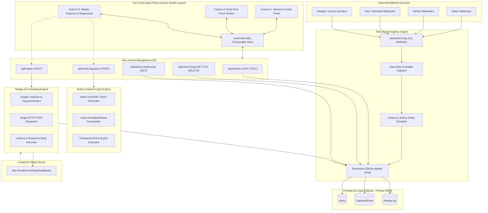
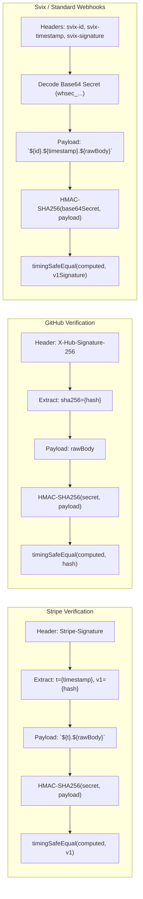
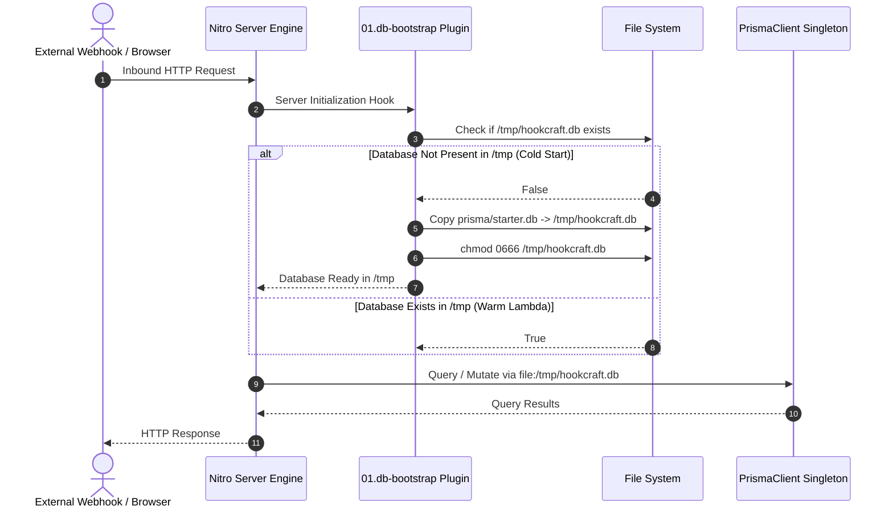

# HookCraft Debugger — System Architecture Specification

## Executive Overview
HookCraft Debugger is a high-performance, local-first developer workbench designed to capture, inspect, verify, and replay inbound HTTP webhooks without leaking payload data to third-party cloud infrastructure.

This document establishes the canonical technical architecture, system blueprints, database schema, API route contracts, frontend component hierarchy, cryptographic engine design, and serverless cold-start resilience strategies for HookCraft Debugger.

---

## 1. System Architecture & High-Level Design

### 1.1 Architectural Blueprint
HookCraft Debugger is architected as an integrated Nuxt 3 full-stack application operating on top of the Nitro server engine and Vue 3 Composition API (`<script setup lang="ts">`).



### 1.2 Data Flow Architecture
1. **Webhook Ingress Cycle:**
   - External provider dispatches HTTP POST/PUT/GET to `/api/inbox/[slug]`.
   - Nitro route interceptor extracts exact raw bytes (`readRawBody`), query params, client IP, and case-preserved headers.
   - The route handler queries the target `Inbox` config for `mockStatusCode` (default 200) and `mockDelayMs` (default 0ms).
   - If `mockDelayMs > 0`, an asynchronous timer suspends execution before responding.
   - The payload and metadata are persisted to SQLite as a `CapturedEvent`.
   - The simulated HTTP status code and response payload are returned to the sender within the defined parameters.

2. **Real-Time Synchronous Stream:**
   - The Vue 3 client polls `/api/inbox/[slug]/events` every 1,500ms using a `since` timestamp query to minimize bandwidth.
   - Polling automatically halts when the browser tab loses focus (`document.hidden`) to prevent resource exhaustion.
   - Newly arrived events trigger an animated badge counter and populate the chronological feed.

3. **Cryptographic Validation Cycle:**
   - The engineer selects an event and navigates to the **Signature Verifier** tab.
   - The user selects a provider preset (Stripe, GitHub, Svix, Shopify, or Generic HMAC) and provides the signing secret.
   - The frontend requests `/api/verify-signature`.
   - Nitro processes the secret against the raw bytes using `node:crypto.createHmac`.
   - Expected and computed digests are compared via `crypto.timingSafeEqual`.
   - The server calculates timestamp drift against current UTC time and returns structured mathematical diagnostics.

4. **Replay & Mutation Cycle:**
   - From the **Replay & Forward** tab, the engineer specifies the local target URL (e.g., `http://localhost:3000/api/webhooks`).
   - The engineer can optionally tamper with the payload JSON or inject custom debug headers.
   - `/api/replay` strips collision-prone hop-by-hop headers (`host`, `content-length`, `connection`), dispatches the HTTP request, captures round-trip latency (`performance.now()`), status code, and response body preview.
   - The replay is saved to `ReplayLog` and linked to the parent `CapturedEvent`.

---

## 2. Technical Stack Specification

| Tier | Technology | Specification / Usage |
|---|---|---|
| **Full-Stack Framework** | Nuxt 3 (v3.11+) | Vue 3 Composition API, `<script setup lang="ts">`, file-based routing, auto-imports. |
| **Server Engine** | Nitro | Node.js high-performance server runtime powering API route handlers (`/server/api/*`). |
| **Language & Typings** | TypeScript (v5.3+) | Strict type safety across client, server, and database models. |
| **Styling & Design System** | Tailwind CSS + `@nuxtjs/tailwindcss` | Minimalist dark-mode editorial theme with strict anti-slop guidelines. |
| **Iconography** | `lucide-vue-next` | Precision stroke SVG icons. **Strictly zero emojis across all UI surfaces.** |
| **Database & ORM** | Prisma ORM + SQLite | Self-contained zero-dependency storage engine with relational constraints and indexes. |
| **Serverless Database Strategy** | SQLite `/tmp` Adapter | Ephemeral `/tmp/hookcraft.db` bootstrap copied from `prisma/starter.db` for zero-setup Vercel deployments. |
| **Cryptography Engine** | `node:crypto` | Native Node.js module (`createHmac`, `timingSafeEqual`, `randomUUID`). |
| **Client State Management** | Pinia / Vue Composable | Unified reactive state machine encapsulated in `useHookCraft()`. |
| **Code & Payload Display** | Prism / Highlight.js / Custom Formatter | Syntax-highlighted JSON viewer, raw payload inspector, and cURL generator. |

---

## 3. Complete Prisma Schema (`prisma/schema.prisma`)

```prisma
datasource db {
  provider = "sqlite"
  url      = env("DATABASE_URL")
}

generator client {
  provider = "prisma-client-js"
}

/// Dynamic Ingress Endpoint Inbox
model Inbox {
  id             String          @id @default(cuid())
  name           String
  slug           String          @unique
  mockStatusCode Int             @default(200)
  mockDelayMs    Int             @default(0)
  createdAt      DateTime        @default(now())
  updatedAt      DateTime        @updatedAt
  events         CapturedEvent[]

  @@index([slug])
  @@map("inboxes")
}

/// Inbound Captured HTTP Webhook Request
model CapturedEvent {
  id             String      @id @default(cuid())
  inboxId        String
  inbox          Inbox       @relation(fields: [inboxId], references: [id], onDelete: Cascade)
  method         String      // POST, GET, PUT, PATCH, DELETE
  path           String      // Path captured at endpoint
  queryParams    String?     // Serialized JSON of URL search parameters
  headersJson    String      // Serialized JSON of inbound HTTP headers
  rawBody        String      // Exact unmodified raw payload string/bytes
  parsedJson     String?     // Formatted JSON string if valid; null if non-JSON payload
  clientIp       String?     // Remote client IP address
  responseStatus Int         // HTTP status code delivered back to the caller
  createdAt      DateTime    @default(now())
  replays        ReplayLog[]

  @@index([inboxId, createdAt])
  @@map("captured_events")
}

/// Outbound Forward / Replay Execution Log
model ReplayLog {
  id                 String        @id @default(cuid())
  eventId            String
  event              CapturedEvent @relation(fields: [eventId], references: [id], onDelete: Cascade)
  targetUrl          String        // Target HTTP endpoint (e.g., http://localhost:3000/api/webhooks)
  requestHeadersJson String        // Serialized JSON of headers sent during replay
  requestBody        String        // Exact payload sent during replay (including any edits)
  responseStatus     Int           // HTTP status code received from target server (or 0 for network failure)
  latencyMs          Int           // Round-trip network latency in milliseconds
  responseBody       String?       // Truncated preview of response body from target (max 10KB)
  createdAt          DateTime      @default(now())

  @@index([eventId, createdAt])
  @@map("replay_logs")
}
```

---

## 4. Directory & File Tree Layout

```
hook-craft-debugger/
├── .env.example
├── .gitignore
├── ARCHITECTURE.md
├── CONCEPT.md
├── PRD.md
├── README.md
├── nuxt.config.ts
├── package.json
├── tailwind.config.ts
├── tsconfig.json
├── prisma/
│   ├── schema.prisma
│   ├── seed.ts
│   └── starter.db                     # Bundled pre-migrated starter SQLite database
├── app.vue                            # Root application shell
├── layouts/
│   └── default.vue                    # Studio three-column responsive layout
├── pages/
│   ├── index.vue                      # Landing & active inbox view
│   └── inboxes/
│       └── [slug].vue                 # Direct link to specific inbox view
├── composables/
│   ├── useHookCraft.ts                # Master state machine for inboxes, events, and inspectors
│   ├── useClipboard.ts                # Safe clipboard copy utility with status feedback
│   └── useCurlGenerator.ts            # Generates executable cURL commands from captured events
├── types/
│   ├── api.ts                         # Request and response contract interfaces
│   ├── database.ts                    # Extended Prisma entity types
│   └── signatures.ts                  # Provider verification presets and diagnostic types
├── server/
│   ├── api/
│   │   ├── inboxes/
│   │   │   ├── index.get.ts           # List all inboxes with metadata and event counts
│   │   │   └── index.post.ts          # Create new inbox endpoint
│   │   ├── inbox/
│   │   │   └── [slug]/
│   │   │       ├── index.get.ts       # Get single inbox configuration
│   │   │       ├── index.put.ts       # Update inbox response rules (status, latency)
│   │   │       ├── index.delete.ts    # Delete inbox and all associated events
│   │   │       ├── events.get.ts      # Fetch captured events with polling & filtering
│   │   │       └── index.all.ts       # Catch-all Webhook Ingress (POST, PUT, GET, etc.)
│   │   ├── verify-signature.post.ts   # Cryptographic HMAC verification endpoint
│   │   └── replay.post.ts             # Dispatch captured event to target local URL
│   ├── plugins/
│   │   └── 01.db-bootstrap.ts         # Nitro startup hook for /tmp database instantiation
│   └── utils/
│       ├── crypto.ts                  # Native crypto verification algorithms (Stripe, GitHub, Svix)
│       ├── db.ts                      # PrismaClient singleton with serverless /tmp adapter
│       └── http.ts                    # Header sanitization and HTTP helper utilities
└── components/
    ├── common/
    │   ├── Badge.vue                  # Semantic status and method badges (POST, 200, 429)
    │   ├── Button.vue                 # Precision styled interactive buttons
    │   ├── CodeBlock.vue              # Monospaced syntax-highlighted code container
    │   ├── EmptyState.vue             # Informational zero-data placeholders with Lucide icons
    │   ├── Modal.vue                  # Minimalist backdrop-blur modal dialog
    │   ├── ShimmerSkeleton.vue        # Shimmer loading skeleton rows
    │   └── TabNav.vue                 # Clean tab switcher for inspector modes
    ├── inboxes/
    │   ├── InboxCard.vue              # Inbox selection item with active indicator
    │   ├── InboxCreateModal.vue       # Create inbox dialog with slug generator
    │   ├── InboxList.vue              # Left column: Inboxes list and quick switcher
    │   └── ResponseRulesEditor.vue    # Config panel for mock response code & latency
    ├── events/
    │   ├── EventItem.vue              # Event stream row item with method, code, size, time
    │   ├── EventList.vue              # Center column: Chronological virtualized list
    │   └── EventSearchBar.vue         # Search input, method filter pills, clear stream button
    ├── inspector/
    │   ├── EventInspector.vue         # Right column: Master container for inspector tabs
    │   ├── HeadersTab.vue             # Key-value header table with search filter
    │   ├── JsonPayloadTab.vue         # Formatted, collapsible JSON tree viewer
    │   ├── RawPayloadTab.vue          # Byte-accurate raw payload display
    │   ├── SignatureVerifierTab.vue   # Cryptographic verification workbench & diff view
    │   └── ReplayTab.vue              # Target forwarding form and payload mutation editor
    └── replay/
        ├── ReplayHistoryTable.vue     # Table of previous replays with status and latency
        └── ReplayStatusBadge.vue      # Latency & HTTP status tag for replay executions
```

---

## 5. Nitro Server API Route Contracts

### 5.1 Inbox Management Endpoints

#### `GET /api/inboxes`
Retrieves all capture inboxes with summarized event telemetry.
- **Method:** `GET`
- **Request Parameters:** None
- **Response `200 OK`:**
```json
{
  "inboxes": [
    {
      "id": "clt92j1h800003b6t5f5g1a2b",
      "name": "Stripe Production Webhooks",
      "slug": "stripe-prod-a8f9",
      "mockStatusCode": 200,
      "mockDelayMs": 0,
      "eventCount": 42,
      "lastEventAt": "2026-10-17T06:05:12.184Z",
      "createdAt": "2026-10-17T05:00:00.000Z",
      "updatedAt": "2026-10-17T06:05:12.184Z"
    }
  ]
}
```

#### `POST /api/inboxes`
Creates a new isolated webhook capture inbox.
- **Method:** `POST`
- **Request Body:**
```json
{
  "name": "GitHub CI Webhooks",
  "slug": "github-ci-test",
  "mockStatusCode": 200,
  "mockDelayMs": 0
}
```
*Note: `slug` is optional. If omitted, a random 8-character URL-safe alphanumeric slug is generated.*
- **Response `201 Created`:**
```json
{
  "inbox": {
    "id": "clt92z9h800013b6txxxxg99a",
    "name": "GitHub CI Webhooks",
    "slug": "github-ci-test",
    "mockStatusCode": 200,
    "mockDelayMs": 0,
    "createdAt": "2026-10-17T06:10:00.000Z",
    "updatedAt": "2026-10-17T06:10:00.000Z"
  }
}
```

#### `GET /api/inbox/:slug`
Fetches configuration for a specific inbox.
- **Method:** `GET`
- **Response `200 OK`:**
```json
{
  "inbox": {
    "id": "clt92z9h800013b6txxxxg99a",
    "name": "GitHub CI Webhooks",
    "slug": "github-ci-test",
    "mockStatusCode": 200,
    "mockDelayMs": 0,
    "createdAt": "2026-10-17T06:10:00.000Z",
    "updatedAt": "2026-10-17T06:10:00.000Z"
  }
}
```
- **Response `404 Not Found`:** `{ "error": "Inbox not found" }`

#### `PUT /api/inbox/:slug`
Updates mock response behavior and chaos rules.
- **Method:** `PUT`
- **Request Body:**
```json
{
  "name": "GitHub CI Webhooks (Throttled)",
  "mockStatusCode": 429,
  "mockDelayMs": 1500
}
```
- **Response `200 OK`:**
```json
{
  "inbox": {
    "id": "clt92z9h800013b6txxxxg99a",
    "name": "GitHub CI Webhooks (Throttled)",
    "slug": "github-ci-test",
    "mockStatusCode": 429,
    "mockDelayMs": 1500,
    "updatedAt": "2026-10-17T06:12:00.000Z"
  }
}
```

#### `DELETE /api/inbox/:slug`
Removes an inbox and cascades deletion across all related captured events and replay logs.
- **Method:** `DELETE`
- **Response `200 OK`:**
```json
{
  "success": true,
  "deletedSlug": "github-ci-test"
}
```

---

### 5.2 Webhook Ingress Catch-All Endpoint

#### `ALL /api/inbox/:slug` (Catch-All Method Handler)
Captures raw incoming webhooks from external providers.
- **Method:** `POST | GET | PUT | PATCH | DELETE | HEAD`
- **Request Payload:** Raw bytes or JSON string.
- **Execution Logic:**
  1. Locates `Inbox` matching `slug`. If none exists, responds `404 Not Found`.
  2. Extracts raw body buffer, headers, query parameters, client IP address.
  3. Checks if raw body is valid JSON; sets `parsedJson` if true.
  4. Delays response if `inbox.mockDelayMs > 0`.
  5. Inserts record into `captured_events`.
  6. Responds with `inbox.mockStatusCode` (e.g., 200, 429, 500).
- **Default Ingress Response `200 OK`:**
```json
{
  "status": "received",
  "eventId": "clt93abc800023b6taaaab11c",
  "inbox": "github-ci-test",
  "timestamp": "2026-10-17T06:14:22.981Z"
}
```

---

### 5.3 Event Query Endpoint

#### `GET /api/inbox/:slug/events`
Fetches captured events for the active inbox with search, filter, and incremental polling support.
- **Method:** `GET`
- **Query Parameters:**
  - `since` *(string, optional)*: ISO timestamp. If supplied, returns only events created after this time.
  - `search` *(string, optional)*: Substring filter against path, headers, or body content.
  - `method` *(string, optional)*: Filter by HTTP method (e.g. `POST`, `GET`).
  - `limit` *(number, optional, default: 50)*: Maximum number of events to return.
- **Response `200 OK`:**
```json
{
  "events": [
    {
      "id": "clt93abc800023b6taaaab11c",
      "inboxId": "clt92z9h800013b6txxxxg99a",
      "method": "POST",
      "path": "/api/inbox/github-ci-test",
      "queryParams": "{\"ref\":\"main\"}",
      "headersJson": "{\"host\":\"localhost:3000\",\"content-type\":\"application/json\",\"x-github-event\":\"push\",\"x-hub-signature-256\":\"sha256=abcdef...\"}",
      "rawBody": "{\"ref\":\"refs/heads/main\",\"commits\":[...]}",
      "parsedJson": "{\n  \"ref\": \"refs/heads/main\",\n  \"commits\": [...]\n}",
      "clientIp": "192.168.1.1",
      "responseStatus": 200,
      "createdAt": "2026-10-17T06:14:22.981Z",
      "_count": {
        "replays": 1
      }
    }
  ],
  "total": 1
}
```

---

### 5.4 Cryptographic Signature Verification Endpoint

#### `POST /api/verify-signature`
Computes and validates cryptographic HMAC signatures across provider presets.
- **Method:** `POST`
- **Request Body:**
```json
{
  "provider": "stripe",
  "rawBody": "{\"id\":\"evt_123\",\"object\":\"event\"}",
  "secret": "whsec_test_secret_key_123",
  "signatureHeader": "t=1700000000,v1=5257a863e586419d8544e43e7ff79998818f0a0d4c7b8849b3806b7d27e1694a",
  "headers": {},
  "algorithm": "sha256",
  "toleranceSeconds": 300
}
```
- **Response `200 OK` (Verification Passed):**
```json
{
  "isValid": true,
  "provider": "stripe",
  "algorithm": "sha256",
  "expectedHash": "5257a863e586419d8544e43e7ff79998818f0a0d4c7b8849b3806b7d27e1694a",
  "calculatedHash": "5257a863e586419d8544e43e7ff79998818f0a0d4c7b8849b3806b7d27e1694a",
  "timestamp": 1700000000,
  "driftSeconds": 14,
  "isExpired": false,
  "diagnostics": [
    "Timestamp extracted: 1700000000 (Drift: +14s, within 300s window)",
    "Signed payload constructed as: 1700000000.{\"id\":\"evt_123\",\"object\":\"event\"}",
    "Constant-time HMAC comparison matched successfully"
  ]
}
```
- **Response `200 OK` (Verification Failed):**
```json
{
  "isValid": false,
  "provider": "stripe",
  "algorithm": "sha256",
  "expectedHash": "5257a863e586419d8544e43e7ff79998818f0a0d4c7b8849b3806b7d27e1694a",
  "calculatedHash": "99818f0a0d4c7b8849b3806b7d27e1694a5257a863e586419d8544e43e7ff7a1",
  "timestamp": 1700000000,
  "driftSeconds": 14,
  "isExpired": false,
  "diagnostics": [
    "Timestamp extracted: 1700000000 (Drift: +14s, within 300s window)",
    "Computed hash does not match signature header digest",
    "Likely causes: Mismatched signing secret, modified payload body whitespace, or incorrect endpoint secret"
  ]
}
```

---

### 5.5 Replay & Forwarding Endpoint

#### `POST /api/replay`
Dispatches a captured event to a local development server or remote target.
- **Method:** `POST`
- **Request Body:**
```json
{
  "eventId": "clt93abc800023b6taaaab11c",
  "targetUrl": "http://localhost:3000/api/webhooks/stripe",
  "method": "POST",
  "headers": {
    "content-type": "application/json",
    "stripe-signature": "t=1700000000,v1=5257a863e586419d8544e43e7ff79998818f0a0d4c7b8849b3806b7d27e1694a",
    "x-hookcraft-replay": "true"
  },
  "body": "{\"id\":\"evt_123\",\"object\":\"event\"}"
}
```
- **Response `200 OK`:**
```json
{
  "success": true,
  "replayLog": {
    "id": "clt94xyz800033b6tppppq99x",
    "eventId": "clt93abc800023b6taaaab11c",
    "targetUrl": "http://localhost:3000/api/webhooks/stripe",
    "requestHeadersJson": "{\"content-type\":\"application/json\",\"stripe-signature\":\"...\",\"x-hookcraft-replay\":\"true\"}",
    "requestBody": "{\"id\":\"evt_123\",\"object\":\"event\"}",
    "responseStatus": 200,
    "latencyMs": 48,
    "responseBody": "{\"received\":true}",
    "createdAt": "2026-10-17T06:18:00.000Z"
  }
}
```
- **Response `200 OK` (When Target Is Down/Unreachable):**
```json
{
  "success": false,
  "replayLog": {
    "id": "clt94xyz800033b6tppppq99x",
    "eventId": "clt93abc800023b6taaaab11c",
    "targetUrl": "http://localhost:3000/api/webhooks/stripe",
    "requestHeadersJson": "...",
    "requestBody": "...",
    "responseStatus": 0,
    "latencyMs": 12,
    "responseBody": "ECONNREFUSED 127.0.0.1:3000: Target server is not reachable",
    "createdAt": "2026-10-17T06:18:00.000Z"
  }
}
```

---

## 6. Frontend Component Hierarchy & State Flow

### 6.1 Component Hierarchy
The UI uses an editorial 3-column layout built for high information density.

```
app.vue
└── layouts/default.vue
    ├── AppHeader.vue (Branding, Global Status, Ingress Host URL indicator, GitHub Link)
    └── pages/index.vue / pages/inboxes/[slug].vue
        ├── Left Column: Inboxes & Ingress Controls (~280px - 320px)
        │   ├── InboxList.vue
        │   │   ├── InboxCard.vue (active border, slug, count badge, copy URL)
        │   │   └── Button.vue (New Inbox trigger)
        │   ├── ResponseRulesEditor.vue (Status dropdown: 200/400/429/500, Latency slider: 0-5000ms)
        │   └── InboxCreateModal.vue (Modal dialog for creating customized inboxes)
        │
        ├── Center Column: Live Event Stream (~360px - 440px)
        │   ├── EventSearchBar.vue (Text search, HTTP Method filter buttons, Clear events action)
        │   └── EventList.vue (Scrollable event stream with live polling)
        │       ├── ShimmerSkeleton.vue (Loading state placeholders)
        │       ├── EmptyState.vue (No events captured yet; cURL test snippet)
        │       └── EventItem.vue (Method badge, response code, relative timestamp, payload size)
        │
        └── Right Column: Detailed Event Inspector & Workbench (Remaining Flex space)
            └── EventInspector.vue (Master inspector container)
                ├── InspectorHeader.vue (Full URL, timestamp, client IP, Copy as cURL)
                ├── TabNav.vue (Headers, Formatted JSON, Raw Payload, Signature Verifier, Replay & Forward)
                ├── HeadersTab.vue (Searchable key-value table of captured headers)
                ├── JsonPayloadTab.vue (Formatted syntax-highlighted collapsible JSON tree)
                ├── RawPayloadTab.vue (Byte-accurate raw text view with line numbers)
                ├── SignatureVerifierTab.vue
                │   ├── ProviderSelector.vue (Stripe, GitHub, Svix, Shopify, Generic)
                │   ├── SecretInput.vue (Masked secret input with reveal toggle)
                │   ├── VerificationDiagnostics.vue (Status banner, expected vs calculated hash, clock-skew)
                │   └── Button.vue (Compute & Verify action)
                └── ReplayTab.vue
                    ├── TargetUrlInput.vue (e.g., http://localhost:3000/api/webhooks)
                    ├── PayloadEditor.vue (Editable payload for data tampering experiments)
                    ├── HeaderEditor.vue (Append custom headers like X-Debug-Replay)
                    ├── Button.vue (Dispatch Replay action)
                    └── ReplayHistoryTable.vue (Previous forward attempts, status codes, latencies)
```

### 6.2 Composable State Flow: `useHookCraft()`

```ts
// composables/useHookCraft.ts
import { ref, computed, watch, onMounted, onUnmounted } from 'vue';
import type { Inbox, CapturedEvent, ReplayLog, VerificationResult } from '~/types';

export function useHookCraft() {
  // --- Global State ---
  const inboxes = ref<Inbox[]>([]);
  const activeInboxSlug = ref<string>('');
  const events = ref<CapturedEvent[]>([]);
  const activeEventId = ref<string>('');
  const isLoadingInboxes = ref<boolean>(false);
  const isLoadingEvents = ref<boolean>(false);
  const isPolling = ref<boolean>(true);
  
  // --- Filters ---
  const searchQuery = ref<string>('');
  const methodFilter = ref<string>('ALL'); // ALL, POST, GET, PUT, DELETE

  // --- Active Selections ---
  const activeInbox = computed(() => 
    inboxes.value.find(i => i.slug === activeInboxSlug.value) || null
  );

  const activeEvent = computed(() => 
    events.value.find(e => e.id === activeEventId.value) || events.value[0] || null
  );

  const filteredEvents = computed(() => {
    return events.value.filter(e => {
      const matchesMethod = methodFilter.value === 'ALL' || e.method === methodFilter.value;
      const query = searchQuery.value.trim().toLowerCase();
      if (!query) return matchesMethod;
      
      const inPath = e.path.toLowerCase().includes(query);
      const inBody = (e.rawBody || '').toLowerCase().includes(query);
      const inHeaders = (e.headersJson || '').toLowerCase().includes(query);
      return matchesMethod && (inPath || inBody || inHeaders);
    });
  });

  // --- Actions: Inboxes ---
  async function fetchInboxes() {
    isLoadingInboxes.value = true;
    try {
      const data = await $fetch<{ inboxes: Inbox[] }>('/api/inboxes');
      inboxes.value = data.inboxes;
      if (!activeInboxSlug.value && inboxes.value.length > 0) {
        activeInboxSlug.value = inboxes.value[0].slug;
      }
    } finally {
      isLoadingInboxes.value = false;
    }
  }

  async function createInbox(payload: { name: string; slug?: string; mockStatusCode?: number; mockDelayMs?: number }) {
    const data = await $fetch<{ inbox: Inbox }>('/api/inboxes', {
      method: 'POST',
      body: payload
    });
    inboxes.value.unshift(data.inbox);
    activeInboxSlug.value = data.inbox.slug;
    await fetchEvents();
    return data.inbox;
  }

  async function updateInboxRules(slug: string, rules: { mockStatusCode: number; mockDelayMs: number }) {
    const data = await $fetch<{ inbox: Inbox }>(`/api/inbox/${slug}`, {
      method: 'PUT',
      body: rules
    });
    const idx = inboxes.value.findIndex(i => i.slug === slug);
    if (idx !== -1) inboxes.value[idx] = { ...inboxes.value[idx], ...data.inbox };
  }

  // --- Actions: Events & Smart Polling ---
  let pollInterval: ReturnType<typeof setInterval> | null = null;

  async function fetchEvents(incremental = false) {
    if (!activeInboxSlug.value) return;
    if (!incremental) isLoadingEvents.value = true;

    try {
      const latestTimestamp = incremental && events.value.length > 0 
        ? events.value[0].createdAt 
        : undefined;

      const data = await $fetch<{ events: CapturedEvent[] }>(`/api/inbox/${activeInboxSlug.value}/events`, {
        params: { since: latestTimestamp }
      });

      if (incremental) {
        if (data.events.length > 0) {
          events.value = [...data.events, ...events.value];
        }
      } else {
        events.value = data.events;
        if (!activeEventId.value && events.value.length > 0) {
          activeEventId.value = events.value[0].id;
        }
      }
    } finally {
      if (!incremental) isLoadingEvents.value = false;
    }
  }

  function startPolling() {
    stopPolling();
    pollInterval = setInterval(() => {
      if (!document.hidden && isPolling.value) {
        fetchEvents(true);
      }
    }, 1500);
  }

  function stopPolling() {
    if (pollInterval) {
      clearInterval(pollInterval);
      pollInterval = null;
    }
  }

  // Auto-refetch when changing inbox
  watch(activeInboxSlug, () => {
    activeEventId.value = '';
    events.value = [];
    fetchEvents();
  });

  return {
    inboxes,
    activeInboxSlug,
    activeInbox,
    events,
    filteredEvents,
    activeEventId,
    activeEvent,
    isLoadingInboxes,
    isLoadingEvents,
    isPolling,
    searchQuery,
    methodFilter,
    fetchInboxes,
    createInbox,
    updateInboxRules,
    fetchEvents,
    startPolling,
    stopPolling
  };
}
```

---

## 7. Design Tokens, Typography, and Anti-Slop Palette

HookCraft Debugger strictly rejects generic AI templates, bright purple SaaS gradients, and emoji iconography. It uses an ultra-restrained, high-density dark workspace inspired by modern developer terminals and high-precision monitoring dashboards.

### 7.1 Color Tokens & CSS Variables

```css
:root {
  /* Canvas & Elevated Backgrounds */
  --bg-canvas: #09090b;       /* Zinc-950 base background */
  --bg-surface: #121215;      /* Elevated card & column panel surface */
  --bg-surface-hover: #18181b;/* Interactive hover state */
  --bg-surface-active: #1c1c21;/* Active selection highlight */

  /* Borders & Dividers */
  --border-subtle: #27272a;   /* Zinc-800 default crisp borders */
  --border-muted: #27272a80;  /* Zinc-800 with 50% opacity for internal dividers */
  --border-focus: #10b981;    /* Emerald-500 focused outline */

  /* Typography Colors */
  --text-primary: #f4f4f5;    /* Zinc-100 high-contrast headings & payloads */
  --text-secondary: #a1a1aa;  /* Zinc-400 field labels, descriptions, metadata */
  --text-muted: #71717a;      /* Zinc-500 timestamps, keys, disabled states */

  /* Intentional Emerald Accent */
  --accent-emerald: #10b981;  /* Emerald-500 primary verified / ingress indicator */
  --accent-emerald-subtle: rgba(16, 185, 129, 0.12); /* Badge background */
  --accent-emerald-border: rgba(16, 185, 129, 0.35); /* Badge border */

  /* Restrained Functional Status Accents */
  --status-success: #10b981;  /* HTTP 2xx & Verified */
  --status-warning: #f59e0b;  /* HTTP 4xx, Rate Limits, Latency delays */
  --status-error: #f43f5e;    /* HTTP 5xx, Signature Mismatches, Connection errors */
  --status-info: #38bdf8;     /* Ingress protocol notices, GET methods */
}
```

### 7.2 Strict Iconography Standard
- **Zero Emojis:** Strictly prohibited everywhere (buttons, notifications, cards, empty states, headers).
- **Lucide SVG Icons:** Precision stroke 1.5px / 1.75px SVG icons from `lucide-vue-next`:
  - `Radio`: Ingress Inbox indicator / live stream listener.
  - `ShieldCheck`: Validated cryptographic signature.
  - `ShieldAlert`: Invalid signature / tampering warning.
  - `Send` / `Play`: Replay & forward action.
  - `Sliders`: Mock response & latency rules.
  - `Copy` / `Check`: One-click clipboard actions.
  - `Terminal`: Export as cURL command.
  - `Code2`: Formatted JSON & raw payload modes.
  - `Search`: Search filter.
  - `Trash2`: Clear logs / delete inbox.
  - `Clock`: Latency, timestamps, and clock-skew delta.

---

## 8. Cryptographic Verification Engine Architecture

Modern webhooks sign payloads using keyed Hash-based Message Authentication Codes (HMAC). A single space character, timestamp mismatch, or incorrect header delimiter invalidates the signature.

HookCraft's verification engine is implemented in `server/utils/crypto.ts` using Node.js native `crypto`.

### 8.1 Supported Provider Specifications



### 8.2 Cryptographic Verification Engine Code Specification

```ts
// server/utils/crypto.ts
import crypto from 'node:crypto';

export interface VerifyOptions {
  provider: 'stripe' | 'github' | 'shopify' | 'svix' | 'generic';
  rawBody: string;
  secret: string;
  signatureHeader?: string;
  headers?: Record<string, string>;
  algorithm?: 'sha256' | 'sha1' | 'sha512';
  toleranceSeconds?: number;
}

export interface VerificationResult {
  isValid: boolean;
  provider: string;
  algorithm: string;
  expectedHash: string;
  calculatedHash: string;
  timestamp?: number;
  driftSeconds?: number;
  isExpired?: boolean;
  diagnostics: string[];
}

export function verifyWebhookSignature(options: VerifyOptions): VerificationResult {
  const { provider, rawBody, secret, signatureHeader = '', headers = {}, toleranceSeconds = 300 } = options;
  const diagnostics: string[] = [];

  switch (provider) {
    case 'stripe': {
      // Stripe Format: t=1700000000,v1=5257a863...[,v0=...]
      const items = signatureHeader.split(',').reduce((acc, part) => {
        const [k, v] = part.split('=');
        if (k && v) acc[k.trim()] = v.trim();
        return acc;
      }, {} as Record<string, string>);

      const timestampStr = items['t'];
      const expectedV1 = items['v1'];

      if (!timestampStr || !expectedV1) {
        return {
          isValid: false,
          provider: 'stripe',
          algorithm: 'sha256',
          expectedHash: expectedV1 || '(missing)',
          calculatedHash: '',
          diagnostics: ['Missing timestamp (t) or signature (v1) in Stripe-Signature header.']
        };
      }

      const timestamp = parseInt(timestampStr, 10);
      const now = Math.floor(Date.now() / 1000);
      const driftSeconds = now - timestamp;
      const isExpired = Math.abs(driftSeconds) > toleranceSeconds;

      diagnostics.push(`Extracted timestamp: ${timestamp} (Clock drift: ${driftSeconds > 0 ? '+' : ''}${driftSeconds}s)`);
      if (isExpired) {
        diagnostics.push(`Warning: Timestamp exceeds tolerance threshold of ${toleranceSeconds}s.`);
      }

      const signedPayload = `${timestampStr}.${rawBody}`;
      const calculatedHash = crypto.createHmac('sha256', secret).update(signedPayload, 'utf8').digest('hex');

      const expectedBuffer = Buffer.from(expectedV1, 'hex');
      const calculatedBuffer = Buffer.from(calculatedHash, 'hex');

      const isValid = expectedBuffer.length === calculatedBuffer.length && 
                      crypto.timingSafeEqual(expectedBuffer, calculatedBuffer);

      diagnostics.push(isValid 
        ? 'Constant-time comparison passed: Signature is valid.' 
        : 'Digest mismatch: Secret may be incorrect, or payload altered.'
      );

      return {
        isValid: isValid && !isExpired,
        provider: 'stripe',
        algorithm: 'sha256',
        expectedHash: expectedV1,
        calculatedHash,
        timestamp,
        driftSeconds,
        isExpired,
        diagnostics
      };
    }

    case 'github': {
      // GitHub Format: sha256=abcdef...
      let expectedHash = signatureHeader;
      let algorithm: 'sha256' | 'sha1' = 'sha256';

      if (signatureHeader.startsWith('sha256=')) {
        expectedHash = signatureHeader.slice(7);
        algorithm = 'sha256';
      } else if (signatureHeader.startsWith('sha1=')) {
        expectedHash = signatureHeader.slice(5);
        algorithm = 'sha1';
      }

      const calculatedHash = crypto.createHmac(algorithm, secret).update(rawBody, 'utf8').digest('hex');
      const expectedBuffer = Buffer.from(expectedHash, 'hex');
      const calculatedBuffer = Buffer.from(calculatedHash, 'hex');

      const isValid = expectedBuffer.length === calculatedBuffer.length && 
                      crypto.timingSafeEqual(expectedBuffer, calculatedBuffer);

      diagnostics.push(`Algorithm: HMAC-${algorithm.toUpperCase()}`);
      diagnostics.push(isValid 
        ? 'Constant-time comparison passed: GitHub signature is authentic.' 
        : 'Signature mismatch: Computed hash does not match header.'
      );

      return {
        isValid,
        provider: 'github',
        algorithm,
        expectedHash,
        calculatedHash,
        diagnostics
      };
    }

    case 'svix': {
      // Svix headers: svix-id, svix-timestamp, svix-signature (v1,base64_hash)
      const id = headers['svix-id'] || '';
      const timestampStr = headers['svix-timestamp'] || '';
      const sigHeader = headers['svix-signature'] || signatureHeader;

      if (!id || !timestampStr || !sigHeader) {
        return {
          isValid: false,
          provider: 'svix',
          algorithm: 'sha256',
          expectedHash: sigHeader,
          calculatedHash: '',
          diagnostics: ['Missing required Svix headers: svix-id, svix-timestamp, or svix-signature.']
        };
      }

      // Secret starts with 'whsec_', remainder is base64
      const cleanSecret = secret.startsWith('whsec_') ? secret.slice(6) : secret;
      const secretBuffer = Buffer.from(cleanSecret, 'base64');

      const timestamp = parseInt(timestampStr, 10);
      const now = Math.floor(Date.now() / 1000);
      const driftSeconds = now - timestamp;
      const isExpired = Math.abs(driftSeconds) > toleranceSeconds;

      const signedContent = `${id}.${timestampStr}.${rawBody}`;
      const calculatedHash = crypto.createHmac('sha256', secretBuffer).update(signedContent, 'utf8').digest('base64');

      // Header can have multiple signatures separated by space: "v1,abc v1,def"
      const passedSignatures = sigHeader.split(' ').map(s => s.replace(/^v1,/, ''));
      const isMatch = passedSignatures.some(expected => {
        const b1 = Buffer.from(expected);
        const b2 = Buffer.from(calculatedHash);
        return b1.length === b2.length && crypto.timingSafeEqual(b1, b2);
      });

      diagnostics.push(`Svix Message ID: ${id}`);
      diagnostics.push(`Timestamp Drift: ${driftSeconds}s (Expired: ${isExpired})`);
      diagnostics.push(isMatch ? 'Svix signature verified successfully.' : 'Svix signature verification failed.');

      return {
        isValid: isMatch && !isExpired,
        provider: 'svix',
        algorithm: 'sha256',
        expectedHash: passedSignatures[0] || sigHeader,
        calculatedHash,
        timestamp,
        driftSeconds,
        isExpired,
        diagnostics
      };
    }

    case 'shopify': {
      // Shopify header: X-Shopify-Hmac-Sha256: base64_digest
      const calculatedHash = crypto.createHmac('sha256', secret).update(rawBody, 'utf8').digest('base64');
      const b1 = Buffer.from(signatureHeader);
      const b2 = Buffer.from(calculatedHash);
      const isValid = b1.length === b2.length && crypto.timingSafeEqual(b1, b2);

      return {
        isValid,
        provider: 'shopify',
        algorithm: 'sha256',
        expectedHash: signatureHeader,
        calculatedHash,
        diagnostics: [isValid ? 'Shopify HMAC verified.' : 'Shopify HMAC failed.']
      };
    }

    default: {
      // Generic HMAC
      const algo = options.algorithm || 'sha256';
      const calculatedHash = crypto.createHmac(algo, secret).update(rawBody, 'utf8').digest('hex');
      const b1 = Buffer.from(signatureHeader, 'hex');
      const b2 = Buffer.from(calculatedHash, 'hex');
      const isValid = b1.length === b2.length && crypto.timingSafeEqual(b1, b2);

      return {
        isValid,
        provider: 'generic',
        algorithm: algo,
        expectedHash: signatureHeader,
        calculatedHash,
        diagnostics: [isValid ? 'Generic HMAC verification matched.' : 'Generic HMAC mismatch.']
      };
    }
  }
}
```

---

## 9. Serverless Deployment Strategy & Cold-Start Resilience for Vercel

### 9.1 The Serverless SQLite Challenge
When deploying a full-stack Next.js or Nuxt application to Vercel Serverless Functions:
1. The lambda execution container filesystem is strictly **read-only**, with the sole exception of `/tmp`.
2. Traditional paths like `file:./prisma/dev.db` cause immediate runtime crashes (`EROFS: read-only file system`) upon any database write operation (such as logging an inbound webhook).
3. SQLite databases are file-based, requiring instant write availability on the first serverless request without requiring external cloud accounts or credentials.

### 9.2 The `/tmp` Cold-Start Adapter Solution
HookCraft Debugger implements a zero-config cold-start adapter:
- A seed-populated SQLite database is stored at `prisma/starter.db` within the git repository. It contains the base schema and two initial sample inboxes:
  - `stripe-payments-demo` (pre-loaded with a simulated `checkout.session.completed` event).
  - `github-webhooks-demo` (pre-loaded with a simulated `push` event).
- During container startup or before any Prisma query executes:
  - The adapter checks if `/tmp/hookcraft.db` exists in the local lambda filesystem.
  - If missing, it synchronously copies `prisma/starter.db` to `/tmp/hookcraft.db` and assigns full read-write permissions (`0o666`).
  - Prisma connects to `file:/tmp/hookcraft.db`.



### 9.3 Cold-Start Adapter Code (`server/utils/db.ts`)

```ts
// server/utils/db.ts
import { PrismaClient } from '@prisma/client';
import fs from 'node:fs';
import path from 'node:path';

let prisma: PrismaClient;

function getDatabaseUrl(): string {
  // If explicitly overridden via environment variable (e.g. Turso / external Postgres)
  if (process.env.DATABASE_URL && !process.env.DATABASE_URL.startsWith('file:')) {
    return process.env.DATABASE_URL;
  }

  const isServerless = process.env.VERCEL || process.env.AWS_LAMBDA_FUNCTION_NAME || process.env.NODE_ENV === 'production';
  
  if (isServerless) {
    const tmpDbPath = '/tmp/hookcraft.db';
    
    // Copy bundled starter database to /tmp if it does not already exist
    if (!fs.existsSync(tmpDbPath)) {
      try {
        // Resolve starter.db relative to project root
        const starterDbPath = path.resolve(process.cwd(), 'prisma/starter.db');
        if (fs.existsSync(starterDbPath)) {
          fs.copyFileSync(starterDbPath, tmpDbPath);
          fs.chmodSync(tmpDbPath, 0o666);
          console.info('[HookCraft DB] Seeded starter database into /tmp/hookcraft.db');
        } else {
          console.warn('[HookCraft DB] starter.db not found at', starterDbPath);
        }
      } catch (err) {
        console.error('[HookCraft DB] Failed to copy starter database to /tmp:', err);
      }
    }
    return `file:${tmpDbPath}`;
  }

  // Local development path
  return process.env.DATABASE_URL || 'file:./prisma/dev.db';
}

declare global {
  var __hookcraft_prisma__: PrismaClient | undefined;
}

export function usePrisma(): PrismaClient {
  if (!prisma) {
    const dbUrl = getDatabaseUrl();
    if (process.env.NODE_ENV === 'production') {
      prisma = new PrismaClient({
        datasources: { db: { url: dbUrl } },
        log: ['error']
      });
    } else {
      if (!global.__hookcraft_prisma__) {
        global.__hookcraft_prisma__ = new PrismaClient({
          datasources: { db: { url: dbUrl } },
          log: ['query', 'error', 'warn']
        });
      }
      prisma = global.__hookcraft_prisma__;
    }
  }
  return prisma;
}
```

---

## 10. Summary & Delivery Checklist

| Architectural Layer | Implementation File / Contract | Status |
|---|---|---|
| **Database Schema** | `prisma/schema.prisma` (`Inbox`, `CapturedEvent`, `ReplayLog`) | Fully Defined |
| **Serverless Cold-Start** | `/tmp` adapter with bundled `prisma/starter.db` | Fully Defined |
| **Ingress Catch-All** | `/server/api/inbox/[slug]/index.all.ts` with chaos latency & status code | Fully Defined |
| **Event Stream Feed** | `/server/api/inbox/[slug]/events.get.ts` with delta polling | Fully Defined |
| **Signature Engine** | `server/utils/crypto.ts` for Stripe, GitHub, Svix, Shopify, Generic | Fully Defined |
| **Forwarder Engine** | `/server/api/replay.post.ts` with round-trip latency & response capture | Fully Defined |
| **Frontend State Machine** | `composables/useHookCraft.ts` (Vue 3 Composition API) | Fully Defined |
| **Anti-Slop Visual System** | Zinc-950 (`#09090b`), Cards (`#121215`), Emerald (`#10b981`), zero emojis | Fully Defined |
