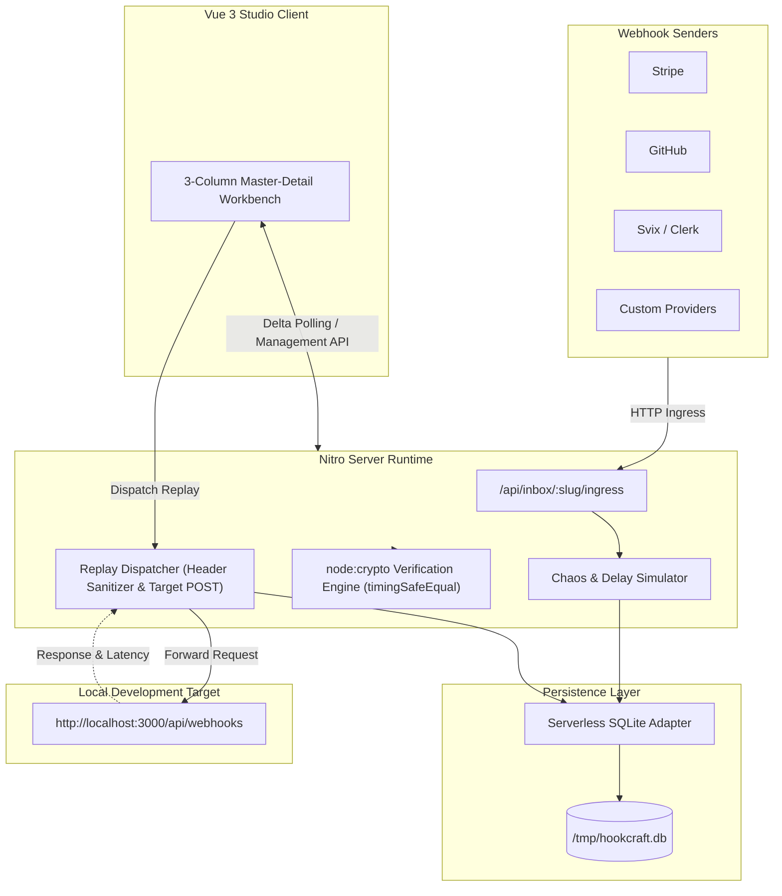

# HookCraft Debugger

[](https://hook-craft-debugger.vercel.app)
[](https://github.com/iammuttaqi/hook-craft-debugger)
[](https://nuxt.com)
[](https://vuejs.org)
[](https://tailwindcss.com)
[](https://prisma.io)
[](tests/verify-all.ts)
[](LICENSE)

HookCraft Debugger is a high-performance, local-first developer workbench designed to capture, inspect, verify, and replay inbound HTTP webhooks without leaking payload data to third-party cloud infrastructure.

- **Production URL:** [https://hook-craft-debugger.vercel.app](https://hook-craft-debugger.vercel.app)
- **Source Code:** [https://github.com/iammuttaqi/hook-craft-debugger](https://github.com/iammuttaqi/hook-craft-debugger)
- **User Guide:** [USER_GUIDE.md](USER_GUIDE.md)
- **Launch Collateral:** [LAUNCH.md](LAUNCH.md)

---

## Value Proposition & Core Capabilities

Public webhook inspectors log customer PII, tokens, and billing metadata onto shared third-party databases with opaque retention policies. Meanwhile, troubleshooting cryptographic signature failures in local environments results in silent `400 Bad Request` errors without diagnostic diffs.

HookCraft Debugger resolves both challenges with a local-first, zero-telemetry studio:

1. **Dynamic Ingress Endpoint Inboxes**
   - Create isolated capture inboxes with unique URL slugs (`/api/inbox/:slug` and `/api/inbox/:slug/ingress`).
   - Supports all HTTP methods (`POST`, `PUT`, `GET`, `PATCH`, `DELETE`).
   - Non-blocking delta polling stream with automatic pause when the browser tab is hidden (`document.hidden`).

2. **Chaos Engineering & Ingress Response Rules**
   - Configure mock HTTP response codes (`200 OK`, `201 Created`, `202 Accepted`, `400 Bad Request`, `401 Unauthorized`, `429 Too Many Requests`, `500 Server Error`, `503 Service Unavailable`).
   - Simulate latency delays (`0ms` to `5000ms` in 100ms increments) to validate upstream timeout thresholds and retry backoff behavior (e.g. Stripe exponential retry schedules).

3. **Cryptographic HMAC Signature Verification Engine**
   - Native Node.js `node:crypto` HMAC calculation using `crypto.timingSafeEqual` constant-time comparisons.
   - Provider presets:
     - **Stripe:** Parses `Stripe-Signature` (`t={timestamp},v1={hash}`), evaluates clock skew against server time, and verifies `HMAC-SHA256(secret, "${t}.${rawBody}")`.
     - **GitHub:** Parses `X-Hub-Signature-256` (`sha256={hash}`) and fallback `X-Hub-Signature` (`sha1={hash}`).
     - **Svix / Standard Webhooks:** Validates canonical message format `${id}.${timestamp}.${rawBody}` using base64-decoded secrets.
     - **Shopify:** Validates base64 digest from `X-Shopify-Hmac-Sha256`.
     - **Generic HMAC:** Custom algorithm (`sha256`, `sha1`, `sha512`) testing.
   - Side-by-side diagnostic diff displaying expected vs calculated digests with clock drift calculation.

4. **Interactive Local Replay & Payload Forwarder**
   - Forward captured webhooks directly to local targets (e.g., `http://localhost:3000/api/webhooks`) with 15-second socket timeouts.
   - In-flight payload mutation to test edge cases without triggering external actions.
   - Header injection (`x-hookcraft-replay: true`) with automatic stripping of hop-by-hop headers (`host`, `content-length`, `connection`).
   - Historical replay execution log recording target status codes, response bodies, and roundtrip duration.

5. **Executable cURL Snippet Generator**
   - One-click export of shell-ready cURL commands replicating the captured method, headers, and escaped raw payload.

---

## User Interface Overview

The interface employs a high-density, three-column master-detail layout:

```
+----------------------------------------------------------------------------------------------------+
| HookCraft Debugger / Active Inbox: stripe-payments-demo         Ingress Host: localhost:3000      |
+--------------------------+------------------------------+------------------------------------------+
| INBOXES                  | EVENT STREAM                 | MASTER EVENT INSPECTOR                   |
|                          |                              |                                          |
| - Stripe Payments (1)    | [Filter by method / search]  | [POST] /api/inbox/stripe-payments-demo   |
| - GitHub Webhooks (1)    |                              | Status: 200 OK | Size: 184 bytes         |
| - Svix Standard (1)      | POST 200 payment_intent.succ |                                          |
|                          | POST 200 push                | [JSON] [Raw] [Headers] [Verify] [Replay] |
| [+ New Inbox]            | POST 200 user.signup         |                                          |
|                          |                              | ---------------------------------------- |
| ------------------------ |                              | Tab Content (Formatted JSON Tree,        |
| Chaos & Ingress Rules    |                              | Cryptographic Verification Diagnostics,  |
| Status: [ 429 Too Many ] |                              | or Local Replay Forwarder)               |
| Delay:  [ 1500 ms      ] |                              |                                          |
+--------------------------+------------------------------+------------------------------------------+
```

---

## Technical Architecture

HookCraft Debugger runs as a full-stack Nuxt 3 application with the Nitro server engine. All operations execute locally or within an isolated serverless function instance.



### Serverless Cold-Start Database Hydration
SQLite does not natively persist across serverless Lambda instances. To provide instant zero-setup operation on platforms like Vercel, HookCraft bundles an embedded pre-seeded SQLite database (`server/utils/starter-db-embedded.ts`). On cold start, the Nitro server automatically initializes `/tmp/hookcraft.db` with sample inboxes and webhook events.

---

## Anti-AI Slop Design Manifesto

HookCraft Debugger was intentionally designed against common AI generation tropes:

1. **Strictly Zero Emojis:** No emojis in buttons, badges, headers, cards, toasts, or empty states. Visual cues rely exclusively on precision stroke SVGs from `lucide-vue-next`.
2. **Editorial Typography:** Monospace fonts (`font-mono`) are prioritized for technical data, hashes, headers, payloads, and endpoints. Clean tabular layouts provide high information density.
3. **Restrained Color Palette:** 
   - Canvas: Zinc-950 (`#09090b`)
   - Surfaces: Zinc-900 (`#18181b`)
   - Borders: Zinc-800 (`#27272a`)
   - Accent: Electric Emerald (`#10b981`) for active states and 2xx responses
   - Semantic Statuses: Restrained Rose (`#f43f5e`) for errors and Amber (`#f59e0b`) for clock drift or warnings.
4. **Authentic Developer Copy:** Clear, concise technical descriptions. No marketing hyperbole or generic buzzwords.

---

## Quickstart Guide

HookCraft Debugger strictly uses `pnpm` as its package manager.

### Prerequisites
- Node.js 18+ (verified on Node 22 and Node 24)
- `pnpm` (v9 or v10)

### 1. Clone & Install
```bash
git clone https://github.com/iammuttaqi/hook-craft-debugger.git
cd hook-craft-debugger

# Install dependencies
pnpm install
```

### 2. Initialize the Database
```bash
# Push Prisma schema to local SQLite
pnpm prisma:push

# (Optional) Seed realistic demonstration inboxes and webhook events
pnpm prisma:seed
```

### 3. Launch Development Server
```bash
pnpm dev
```
Open `http://localhost:3000` in your browser.

### 4. Run Automated Test Suite
```bash
pnpm test
```
Executes the 22-test automated verification suite covering cryptographic HMAC verification, database cascading operations, cURL generators, and serverless cold-start simulation.

### 5. Production Build
```bash
pnpm build
node .output/server/index.mjs
```

---

## Docker Deployment

Build and run HookCraft Debugger in a self-contained container:

```bash
# Build Docker image
docker build -t hook-craft-debugger .

# Run container
docker run -d \
  -p 3000:3000 \
  --name hook-craft \
  -e NODE_ENV=production \
  hook-craft-debugger
```

Access the studio at `http://localhost:3000`.

---

## API Reference

| Endpoint | Method | Description |
|---|---|---|
| `/api/inboxes` | `GET` | Lists all inboxes with event counts and activity timestamps |
| `/api/inboxes` | `POST` | Creates a new capture inbox with optional custom slug |
| `/api/inbox/:slug` | `GET` | Fetches configuration for a specific inbox |
| `/api/inbox/:slug` | `PUT` | Updates mock response status and artificial latency delay |
| `/api/inbox/:slug` | `DELETE` | Deletes an inbox and cascades deletion of events and replays |
| `/api/inbox/:slug/events` | `GET` | Fetches captured events with search, method filter, and delta polling (`?since=`) |
| `/api/inbox/:slug` | `ALL` | Ingress endpoint capturing raw body, headers, and metadata |
| `/api/inbox/:slug/ingress` | `ALL` | Catch-all ingress endpoint for all HTTP methods |
| `/api/verify-signature` | `POST` | Validates HMAC signature against raw body and secret with timingSafeEqual |
| `/api/replay` | `POST` | Forwards captured webhook to target URL and records response latency |

---

## Demonstration Credentials

Pre-loaded seed data contains the following demonstration signing secrets for quick testing:

| Provider | Demo Inbox Slug | Signing Secret |
|---|---|---|
| **Stripe** | `stripe-payments-demo` | `whsec_test_stripe_secret_123` |
| **GitHub** | `github-webhooks-demo` | `gh_secret_test_456` |
| **Svix / Standard** | `svix-standard-demo` | `whsec_MfKQ9r8GKYqrTwjUPD8ILPZIo2LaLaSw` |

---

## License

MIT License. Designed and maintained for backend engineers and developer teams.
